

# SCAQ-Mask

### Small-Component-Aware Query Mask Segmentation for Spacecraft Components in Close-Range On-Orbit Servicing

Zhuo Song · Qin Yang · Zexu Zhang · Fan Zhang · Yingshuo Li · Yicheng Mao · Wenjun Tian · Jingchen Yan · Weimin Bao

Harbin Institute of Technology · China Aerospace Science and Technology Corporation

[Demonstration](#demonstration-video) · [Method](#method) · [Dataset examples](#dataset-examples) · [Results](#experimental-results)

**SCAQ-Mask** improves the training exposure and local feature discrimination of small spacecraft components for close-range on-orbit servicing. Built on Mask2Former–Swin-S, it combines prior-guided context-preserving sampling with local-neighbourhood auxiliary supervision. Both enhancements operate during training and introduce no additional inference-time parameters.

## Demonstration Video

[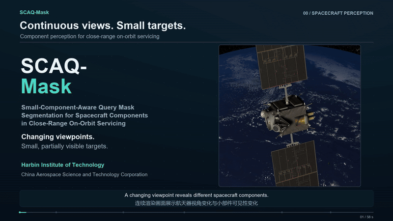](assets/demo/scaq_mask_demo.mp4)

**[Open / download the full demonstration](assets/demo/scaq_mask_demo.mp4)** — 58 s · 1920 × 1080 · H.264 MP4 · English labels and Chinese subtitles · no audio. [Static cover](assets/demo/cover.png).

The video illustrates spacecraft viewpoint changes, the two training strategies, selected small-component comparisons, and synchronized RGB, predicted masks and overlays. The qualitative predictions shown here are from the **A4 sampling variant**. The prediction segment shows 20 available test views in source order; it is a sampled-view demonstration.

## Method

1. **Prior-guided context-preserving sampling.** Training annotations guide crop selection toward small components, while surrounding spacecraft structures remain visible as context. A bounded offset preserves sampling diversity.
2. **Local-neighbourhood auxiliary supervision.** An auxiliary head supervises pixel-decoder mask features using target foregrounds and nearby non-target regions, while excluding distant regions from this loss. The auxiliary head is removed at inference.
3. **Structured task-region representation.** Predicted masks are organized into component categories, spatial attributes, confidence-derived region uncertainty, and candidate spatial relationships for subsequent region assessment.

<b>View the training illustrations</b>

**Prior-guided sampling**

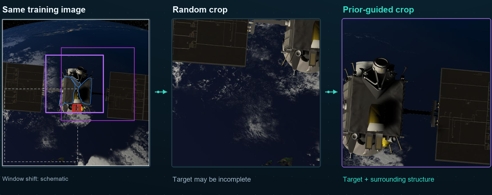

**Local-neighbourhood auxiliary supervision**

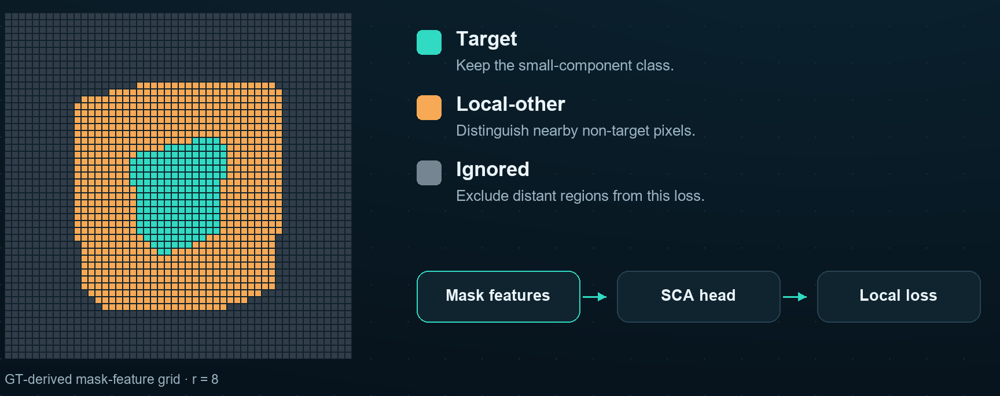

These panels reuse the demonstration video's illustrations. Crop-window movement and the feature grid explain the training concepts schematically.

## Dataset Examples

The Unity-based simulated dataset contains **10,210 RGB images**, pixel-wise annotations for **15 semantic classes**, and a **1,531-image test set**. The small-component subset comprises Camera, Reaction Wheels, Low-Gain Antenna, Star Tracker and CSS.

Two test views are shown below. Ground truth and predictions use the same colour map. **Prediction columns show the A4 sampling variant.**

| Input RGB | Ground truth | A4 sampling variant prediction |
|:---:|:---:|:---:|
| 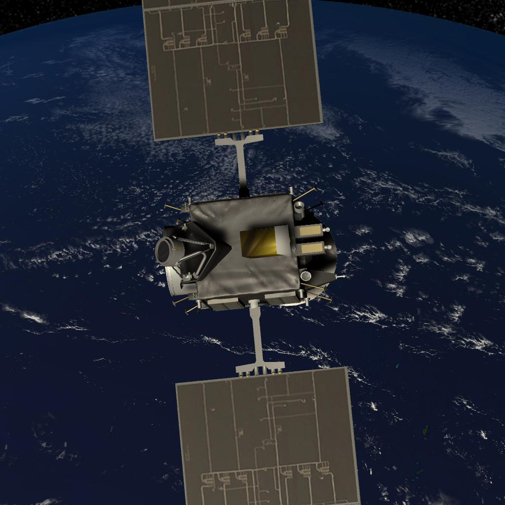 | 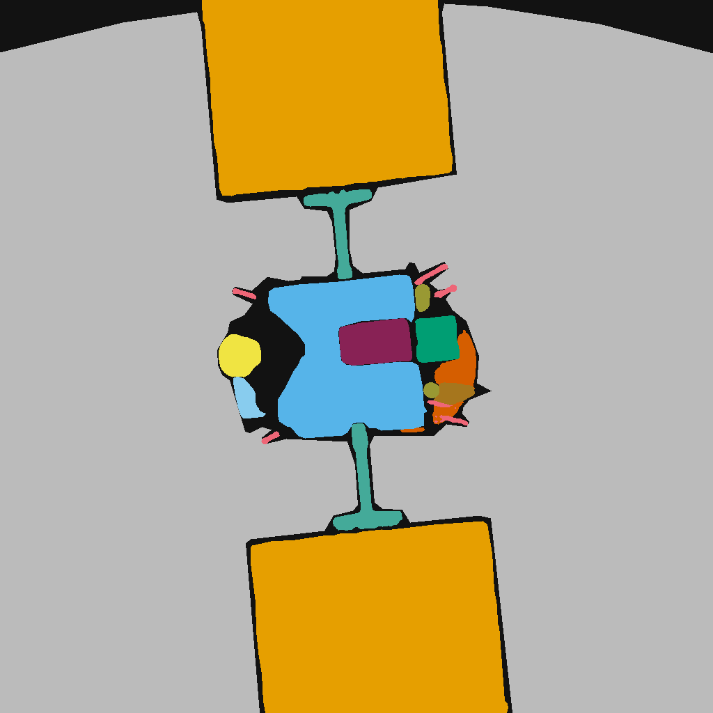 | 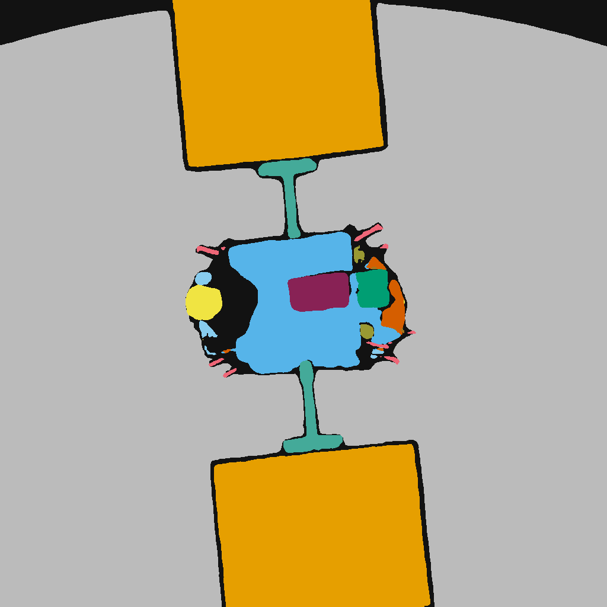 |
| 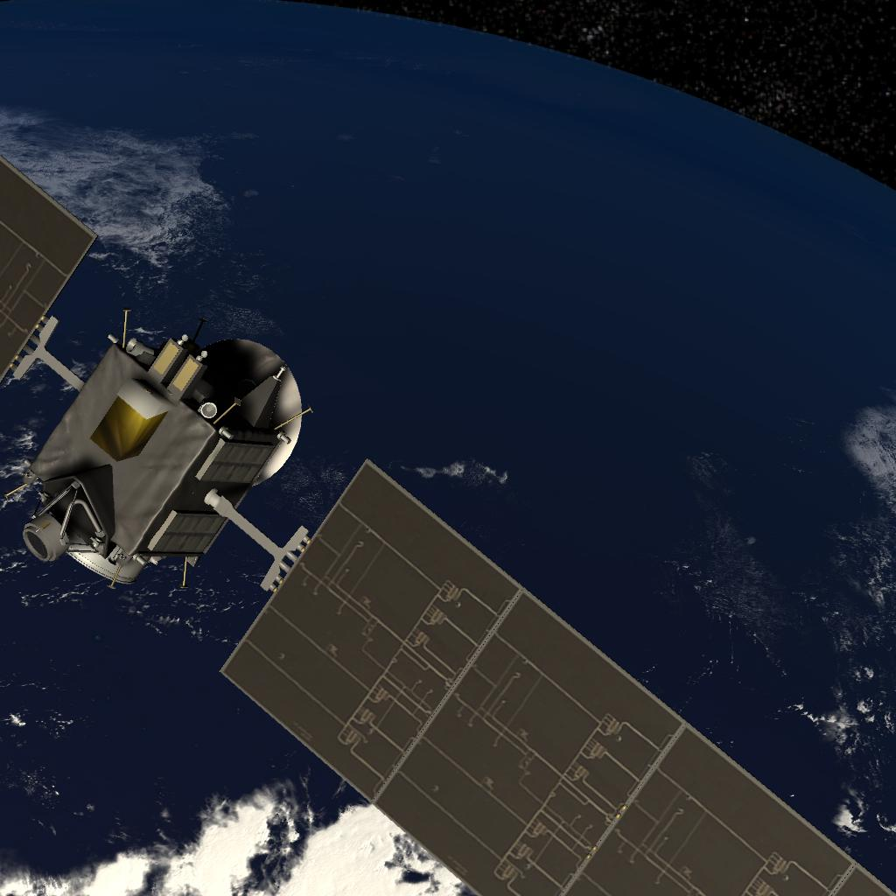 | 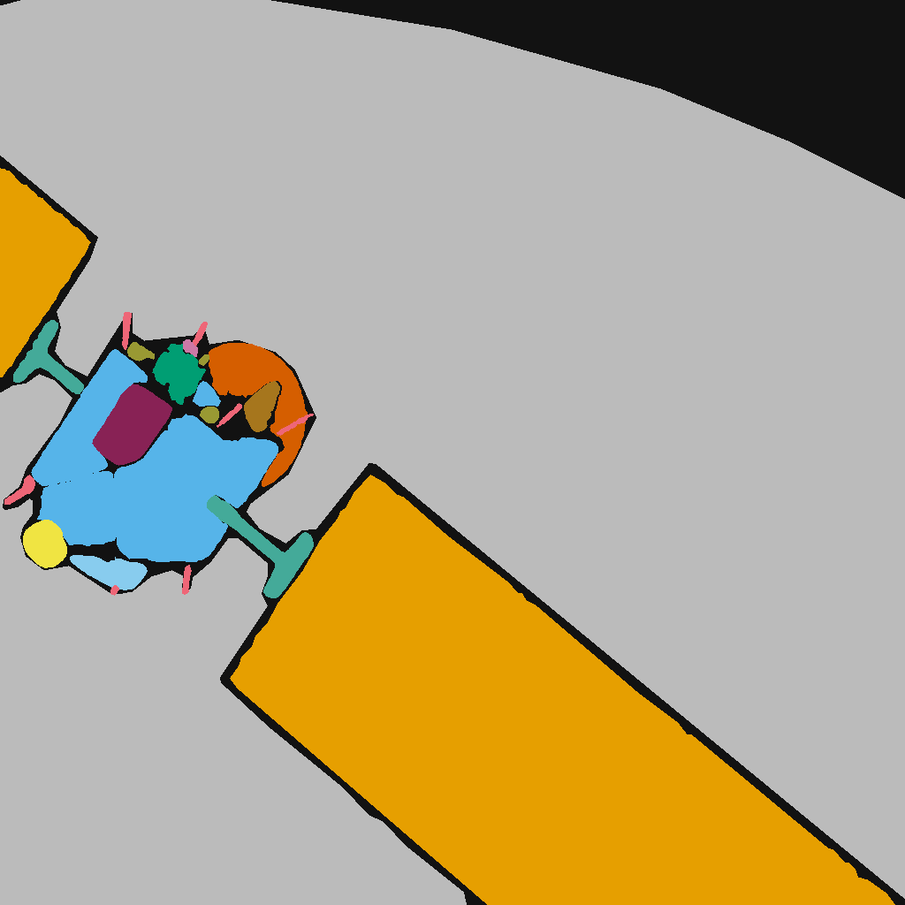 | 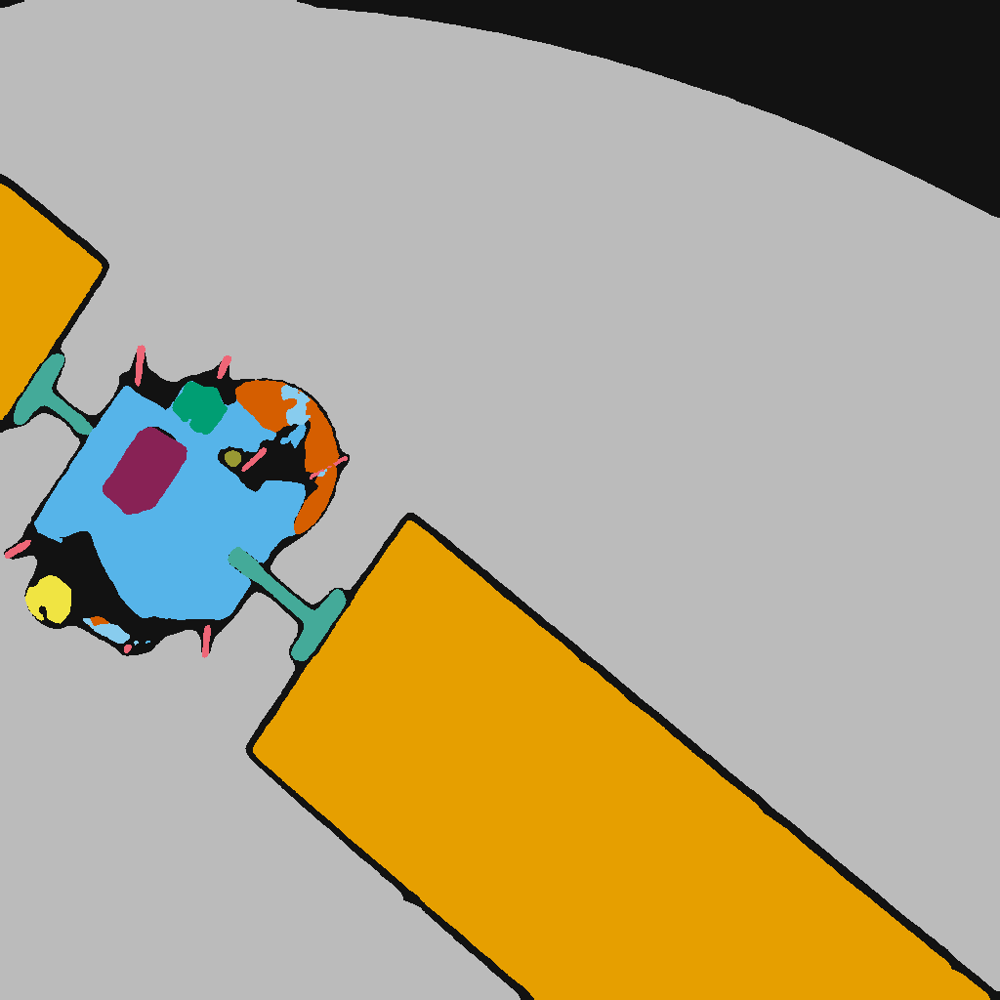 |

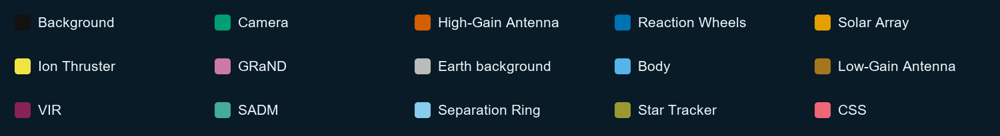

The full dataset download and dataset documentation will be added when available. These examples are selected visualizations, not a complete dataset release.

<b>View a small-component comparison</b>

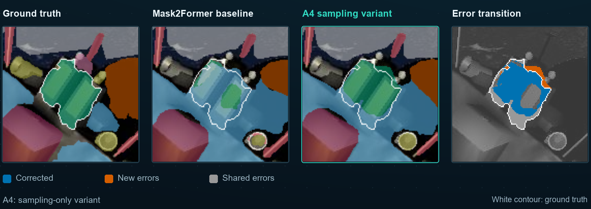

The white contour marks the ground truth. Blue marks corrected errors, orange marks new errors, and grey marks errors shared by the baseline and A4 variant. This selected positive example also retains the remaining errors.

## Experimental Results

The paper reports the following results for **SCAQ-Mask (Full)** on the simulated close-range spacecraft test set, compared with the architecture-matched Mask2Former–Swin-S baseline.

| Metric | SCAQ-Mask (Full) | Gain over baseline |
|:---|---:|---:|
| Overall mIoU | **88.92%** | **+0.27 percentage points** |
| Small-component mIoU | **81.51%** | **+0.93 percentage points** |

The improvements vary by component class; Reaction Wheels decreases by **1.55 percentage points**. The confidence-derived region uncertainty achieves **AUROC 0.911** and **AUPRC 0.942** for distinguishing valid from invalid predicted component regions.

The table describes the Full method reported in the paper. The A4 qualitative examples above are a sampling ablation and do not reproduce the Full method's test-set results.

## Code and Reproducibility

This project page provides the demonstration video, method illustrations and selected dataset visualizations. Environment setup, training and inference instructions, model configurations and checkpoints will be added as the implementation is released.

Image provenance, palette values and media checksums are recorded in [the media manifest](assets/meta/media_manifest.json).

## Paper

**SCAQ-Mask: Small-Component-Aware Query Mask Segmentation for Spacecraft Components in Close-Range On-Orbit Servicing**

The paper link and citation will be added when available.

## License

Repository code is provided under the [MIT License](LICENSE). Dataset and third-party asset terms are separate from the code license.
